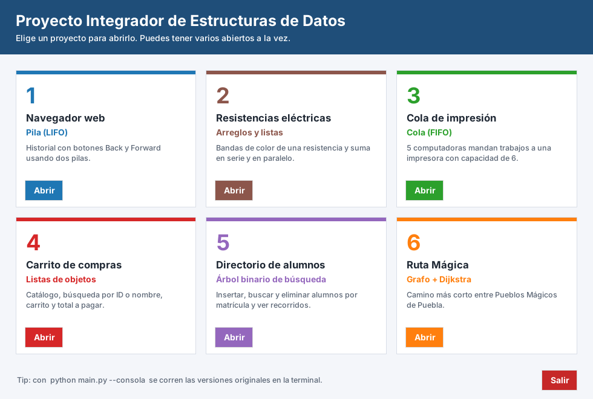
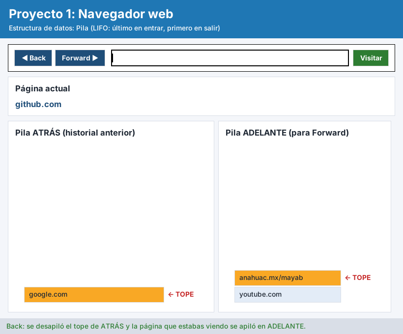
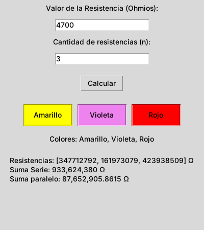
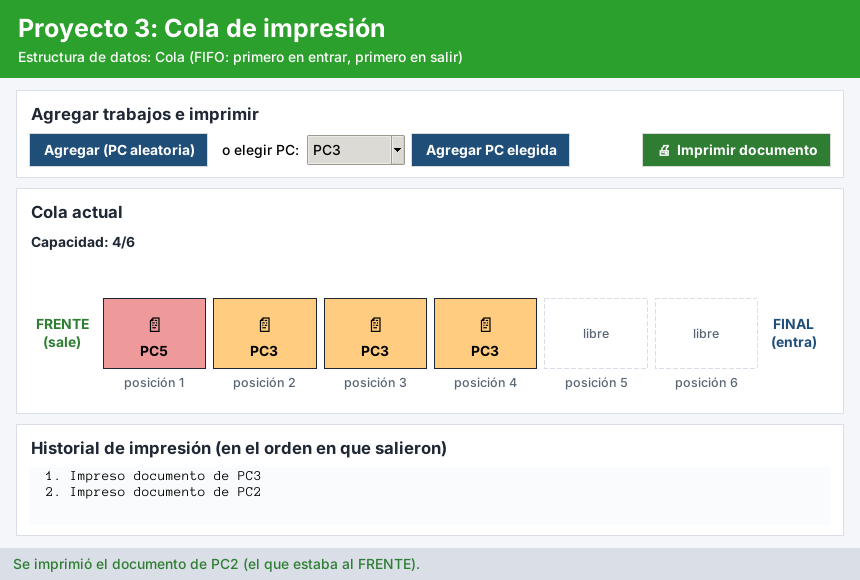
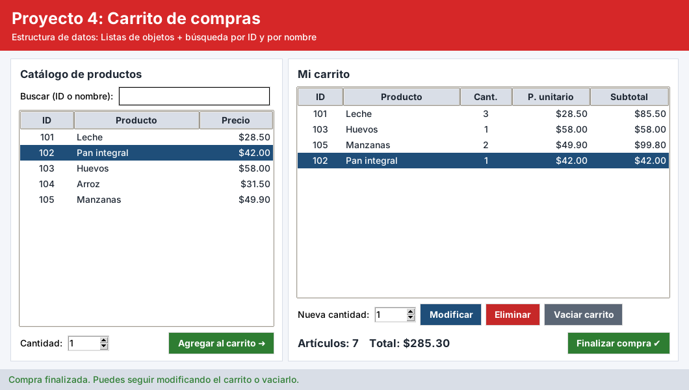
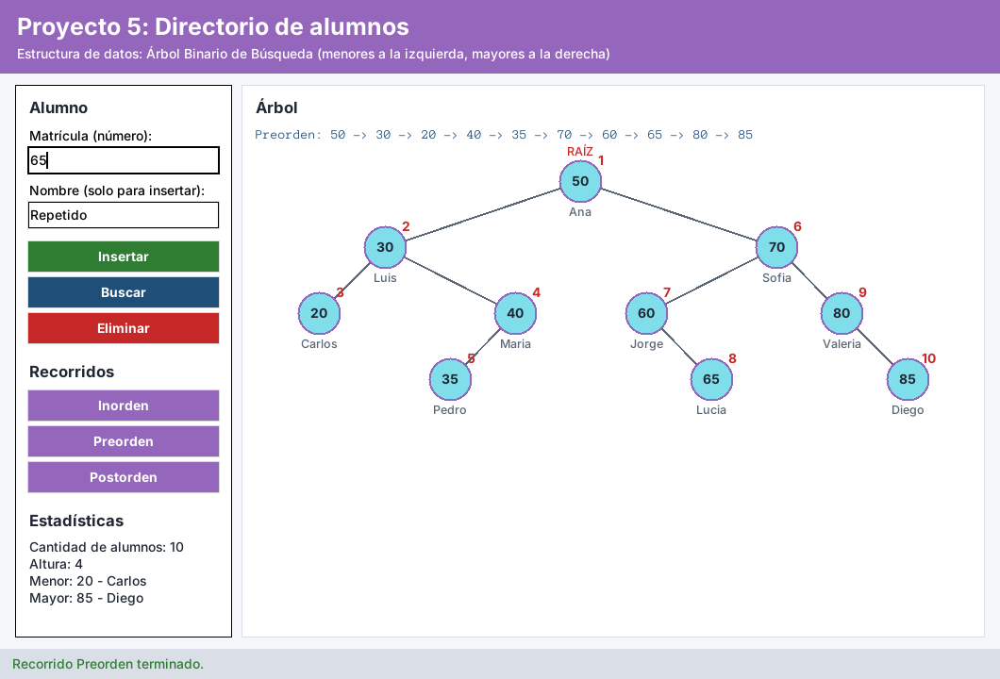
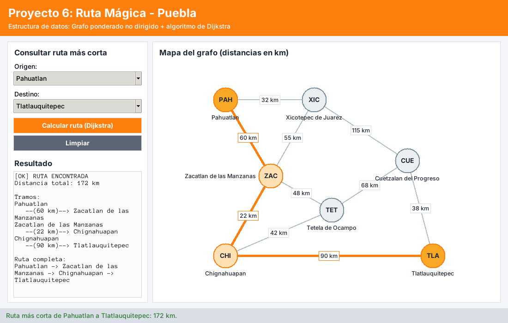

# Proyecto Integrador de Estructuras de Datos

Aplicación en **Python + Tkinter** que junta en un solo programa los **6 proyectos** de la materia de Estructuras de Datos. Al ejecutarla aparece un menú gráfico con 6 opciones; cada opción abre la ventana de ese proyecto.



| # | Proyecto | Estructura de datos | Archivo original |
|---|----------|---------------------|------------------|
| 1 | Navegador web (Back / Forward) | **Pila** (LIFO) | `proyectos/p1_navegador_web.py` |
| 2 | Resistencias eléctricas | **Arreglos / tuplas y listas** | `proyectos/p2_resistencias.py` |
| 3 | Cola de impresión | **Cola** (FIFO) con capacidad limitada | `proyectos/p3_cola_impresion.py` |
| 4 | Carrito de compras | **Listas de objetos** + búsqueda | `proyectos/p4_carrito_compras.py` |
| 5 | Directorio de alumnos | **Árbol binario de búsqueda** | `proyectos/p5_arbol_alumnos.py` |
| 6 | Ruta Mágica (Pueblos Mágicos de Puebla) | **Grafo ponderado** + Dijkstra | `proyectos/p6_pueblos_magicos.py` |

---

## Cómo ejecutarlo

**Requisitos:** Python 3.8 o más nuevo. No hay que instalar nada extra: solo se usa la biblioteca estándar (`tkinter`, `random`, `heapq`, `dataclasses`, `typing`). En Windows y macOS Tkinter ya viene con Python; en Linux puede hacer falta `sudo apt install python3-tk`.

```bash
git clone https://github.com/saimonetii/Estructura_Proyecto.git
cd Estructura_Proyecto

python main.py             # menú gráfico (lo normal)
python main.py --consola   # menú en la terminal con los programas originales
```

> En Windows, si `python` no funciona, prueba con `py main.py`.

**En VS Code:** *File → Open Folder* y elige la carpeta del repo, abre `main.py` y presiona ▶ (*Run Python File*). Importante: abre la **carpeta completa**, no solo el archivo, para que encuentre `proyectos/` e `interfaz/`.

Cada proyecto también se puede correr solo, en su versión original de consola:

```bash
python proyectos/p1_navegador_web.py
python proyectos/p5_arbol_alumnos.py
```

---

## Cómo está organizado

```
Estructura_Proyecto/
├── main.py                  ← EL ÚNICO QUE SE EJECUTA: menú con las 6 opciones
├── proyectos/               ← el código de cada proyecto, SIN CAMBIOS
│   ├── p1_navegador_web.py
│   ├── p2_resistencias.py
│   ├── p3_cola_impresion.py
│   ├── p4_carrito_compras.py
│   ├── p5_arbol_alumnos.py
│   └── p6_pueblos_magicos.py
├── interfaz/                ← ventanas gráficas (Tkinter), una por proyecto
│   ├── estilos.py           ← colores, fuentes y botones compartidos
│   ├── ventana_navegador.py
│   ├── ventana_cola.py
│   ├── ventana_carrito.py
│   ├── ventana_arbol.py
│   └── ventana_pueblos.py
├── docs/                    ← documentación detallada de cada proyecto
├── CODIGO/                  ← entrega original del proyecto 2 (septiembre)
└── DOCUMENTACION/           ← documentación original del proyecto 2 (septiembre)
```

### La idea principal: separar la lógica de la interfaz

Los códigos de los proyectos se integraron **sin modificarlos**. Las ventanas de la carpeta `interfaz/` solo **importan las clases originales y llaman a sus métodos**. Por ejemplo, el botón *Back* del navegador hace exactamente esto:

```python
from proyectos.p1_navegador_web import NavegadorWeb

self.navegador = NavegadorWeb()      # objeto del código original
...
self.navegador.retroceder()          # método original, sin cambios
```

Así, la parte de estructuras de datos (lo que se califica) queda igual que como se entregó, y la interfaz solo la muestra de forma visual.

El **proyecto 2 (Resistencias)** ya era una ventana de Tkinter completa, así que el menú simplemente ejecuta su archivo original tal cual.

El **proyecto 5 (Árbol binario de búsqueda)** es nuevo y se escribió con el mismo estilo que los demás (clases + menú de consola).

Más detalle en [docs/arquitectura.md](docs/arquitectura.md).

---

## Documentación

Cada proyecto tiene su propio documento en la carpeta [`docs/`](docs/) que explica **qué hace, la estructura de datos que usa, cómo funciona el código paso a paso, ejemplos, complejidad, cómo es su ventana y preguntas que podría hacer el profe**:

| Documento | Contenido |
|-----------|-----------|
| [docs/arquitectura.md](docs/arquitectura.md) | Cómo se unieron los 6 códigos, qué hace `main.py` y cómo están hechas las ventanas |
| [docs/1_navegador_pila.md](docs/1_navegador_pila.md) | Pila, Back/Forward con dos pilas |
| [docs/2_resistencias_arreglos.md](docs/2_resistencias_arreglos.md) | Arreglos paralelos, bandas de color, serie y paralelo |
| [docs/3_cola_impresion.md](docs/3_cola_impresion.md) | Cola FIFO con capacidad limitada |
| [docs/4_carrito_listas.md](docs/4_carrito_listas.md) | Listas de objetos, `dataclass` y búsqueda lineal |
| [docs/5_arbol_binario.md](docs/5_arbol_binario.md) | Árbol binario de búsqueda: insertar, buscar, eliminar (3 casos) y recorridos |
| [docs/6_grafo_dijkstra.md](docs/6_grafo_dijkstra.md) | Grafo ponderado, lista de adyacencia y Dijkstra |

---

## Los 6 proyectos

### 1. Navegador web — Pila
Simula los botones **Back** y **Forward** de un navegador con dos pilas: `pila_atras` y `pila_adelante`. Visitar una página apila la actual en *atrás* y vacía *adelante*. La ventana dibuja las dos pilas y marca el **tope**.
→ [docs/1_navegador_pila.md](docs/1_navegador_pila.md)



### 2. Resistencias eléctricas — Arreglos y listas
Usa dos arreglos paralelos (nombres de colores y códigos hexadecimales) para obtener las **3 bandas de color** de una resistencia, y calcula la resistencia equivalente **en serie** y **en paralelo** de *n* resistencias aleatorias.
→ [docs/2_resistencias_arreglos.md](docs/2_resistencias_arreglos.md)



### 3. Cola de impresión — Cola FIFO
Cinco computadoras (PC1 a PC5) mandan trabajos a una impresora con **capacidad máxima de 6**. Se imprime siempre el primero que llegó. La ventana dibuja el **frente** y el **final** de la cola.
→ [docs/3_cola_impresion.md](docs/3_cola_impresion.md)



### 4. Carrito de compras — Listas de objetos
Catálogo de productos y carrito como listas de objetos (`Producto`, `ElementoCarrito`). Búsqueda por **ID** o por **nombre**, agregar, modificar cantidad, eliminar, vaciar y finalizar la compra con el total.
→ [docs/4_carrito_listas.md](docs/4_carrito_listas.md)



### 5. Directorio de alumnos — Árbol binario de búsqueda
Guarda alumnos ordenados por **matrícula**: los menores a la izquierda y los mayores a la derecha. Permite insertar, buscar (mostrando el camino recorrido), eliminar (los 3 casos) y ver los recorridos **inorden, preorden y postorden** animados.
→ [docs/5_arbol_binario.md](docs/5_arbol_binario.md)



### 6. Ruta Mágica — Grafo + Dijkstra
Los Pueblos Mágicos de la Sierra Norte de Puebla son los **vértices** y las carreteras con sus kilómetros son las **aristas**. El algoritmo de **Dijkstra** encuentra la ruta más corta y la ventana la pinta en el mapa.
→ [docs/6_grafo_dijkstra.md](docs/6_grafo_dijkstra.md)



---

## Resumen de complejidades

| Proyecto | Operación | Complejidad |
|----------|-----------|-------------|
| Pila | apilar / desapilar / ver tope | O(1) |
| Arreglos | bandas de color | O(d), d = número de dígitos |
| Arreglos | suma serie / paralelo | O(n) |
| Cola | encolar | O(1) |
| Cola | desencolar con `list.pop(0)` | O(n) (con `collections.deque` sería O(1)) |
| Listas | buscar por ID o nombre | O(n) (búsqueda lineal) |
| Árbol | insertar / buscar / eliminar | O(h): O(log n) si está balanceado, O(n) en el peor caso |
| Árbol | recorridos | O(n) |
| Grafo | Dijkstra con montículo (`heapq`) | O((V + E) log V) |

---

## Integrantes

- Samuel Coronado
- *(agregar a los demás integrantes del equipo)*

Universidad Anáhuac Mayab — Estructuras de Datos
