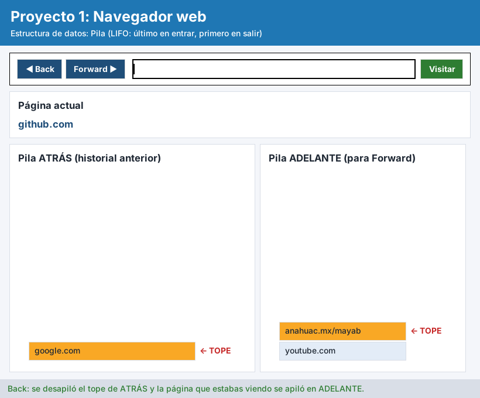

# Proyecto 1 — Navegador web con Pilas (LIFO)

[← Volver al README](../README.md) · Código: [`proyectos/p1_navegador_web.py`](../proyectos/p1_navegador_web.py) · Ventana: [`interfaz/ventana_navegador.py`](../interfaz/ventana_navegador.py)

## ¿Qué hace?

Simula el historial de un navegador con los botones **Back** (regresar) y **Forward** (avanzar).

## La estructura: Pila

Una **pila** es una colección donde el **último en entrar es el primero en salir** (LIFO, *Last In, First Out*), como una pila de platos: solo se pone o se quita el de **arriba (el tope)**.

| Operación | Método | Qué hace | Complejidad |
|-----------|--------|----------|-------------|
| push | `apilar(e)` | pone `e` en el tope (`list.append`) | O(1) |
| pop | `desapilar()` | quita y regresa el tope (`list.pop()`) | O(1) |
| peek | `ver_tope()` | regresa el tope sin quitarlo (`lista[-1]`) | O(1) |
| | `esta_vacia()` | `len(self.elementos) == 0` | O(1) |
| | `vaciar()` | `self.elementos = []` | O(1) |

La pila usa una lista de Python y **el final de la lista es el tope**, porque agregar y quitar al final es O(1).

## ¿Por qué dos pilas?

`NavegadorWeb` tiene:

- `pila_atras`: páginas que visitaste **antes** de la actual.
- `pila_adelante`: páginas de las que **regresaste** con Back (para poder hacer Forward).
- `pagina_actual`: la que se está viendo (no está en ninguna pila).

### Reglas

| Acción | Qué pasa |
|--------|----------|
| **Visitar** `url` | Si hay página actual, se **apila en atrás**. Se **vacía adelante** (ya no tiene sentido avanzar). La actual pasa a ser `url`. |
| **Back** | Si `atrás` está vacía → mensaje de error. Si no: la actual se **apila en adelante** y la nueva actual es lo que se **desapila de atrás**. |
| **Forward** | Si `adelante` está vacía → mensaje de error. Si no: la actual se **apila en atrás** y la nueva actual es lo que se **desapila de adelante**. |

### Ejemplo

| Paso | Actual | Pila atrás (tope a la derecha) | Pila adelante |
|------|--------|-------------------------------|---------------|
| Visitar google.com | google.com | [] | [] |
| Visitar github.com | github.com | [google.com] | [] |
| Visitar youtube.com | youtube.com | [google.com, github.com] | [] |
| Back | github.com | [google.com] | [youtube.com] |
| Back | google.com | [] | [youtube.com, github.com] |
| Forward | github.com | [google.com] | [youtube.com] |
| Visitar anahuac.mx | anahuac.mx | [google.com, github.com] | [] ← se vació |

## La ventana gráfica

- Barra tipo navegador: **◀ Back**, **Forward ▶**, el cuadro para la URL y **Visitar** (también funciona con Enter).
- Los botones Back/Forward se **desactivan** cuando su pila está vacía.
- Abajo se dibujan las **dos pilas** como cajas apiladas; la del tope está en amarillo con la etiqueta **← TOPE**.

## Preguntas que podría hacer el profe

- **¿Por qué se vacía la pila adelante al visitar una página nueva?** Porque al abrir una página nueva se crea una "rama" nueva en el historial; las páginas a las que se podía avanzar ya no siguen a la actual. Así funcionan los navegadores reales.
- **¿Por qué el tope es el final de la lista y no el inicio?** Porque `append()` y `pop()` al final son O(1); insertar o quitar al inicio (`insert(0, x)`, `pop(0)`) es O(n) porque hay que recorrer todos los elementos.
- **¿Qué pasa si hago Back sin historial?** `retroceder()` revisa `esta_vacia()` antes de desapilar, así que solo muestra el mensaje y no truena.
