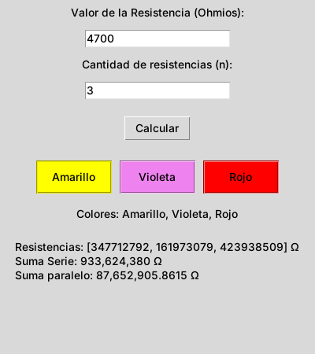

# Proyecto 2 — Resistencias eléctricas con Arreglos y Listas

[← Volver al README](../README.md) · Código: [`proyectos/p2_resistencias.py`](../proyectos/p2_resistencias.py)

## ¿Qué hace?

1. Recibe el **valor de una resistencia** en ohmios y muestra sus **3 bandas de color**.
2. Genera **n resistencias aleatorias** y calcula su resistencia equivalente **en serie** y **en paralelo**.

Este proyecto ya tenía interfaz gráfica con Tkinter, así que el menú principal **ejecuta el archivo original tal cual**.

## La estructura: Arreglos paralelos

En la clase `Resistencia` hay dos arreglos (listas) del mismo tamaño, donde la **posición** (índice) es el dígito:

| Índice | 0 | 1 | 2 | 3 | 4 | 5 | 6 | 7 | 8 | 9 |
|--------|---|---|---|---|---|---|---|---|---|---|
| `colores` | Negro | Marrón | Rojo | Naranja | Amarillo | Verde | Azul | Violeta | Gris | Blanco |
| `codigos_hex` | #000000 | #8B4513 | #FF0000 | #FFA500 | #FFFF00 | #008000 | #0000FF | #EE82EE | #808080 | #FFFFFF |

Se llaman **paralelos** porque `colores[i]` y `codigos_hex[i]` hablan de lo mismo. Acceder por índice es **O(1)**.

## `obtener_colores(valor)` paso a paso

El código de colores de una resistencia es: **1.ª banda** = primer dígito, **2.ª banda** = segundo dígito, **3.ª banda (multiplicador)** = cuántos ceros siguen.

```python
valor_str = str(valor)                    # 4700 -> "4700"
digito1 = int(valor_str[0])               # 4
digito2 = int(valor_str[1])               # 7
multiplicador = len(valor_str) - 2        # 4 - 2 = 2  (dos ceros)
nombres = (colores[4], colores[7], colores[2])   # Amarillo, Violeta, Rojo
```

Regresa dos **tuplas** (arreglos que no se pueden modificar): los nombres y los colores hexadecimales para pintar las etiquetas.

Validaciones:

- Si el valor tiene **2 dígitos o menos** (menor que 100) regresa `None, None` y se muestra un error. Con este método de 3 bandas el multiplicador mínimo es 1 (un cero).
- Si el multiplicador es **mayor que 9** (más de 11 dígitos) también es inválido, porque solo hay 10 colores.

> Nota: solo se usan los **dos primeros dígitos**; por ejemplo, 4750 se muestra igual que 4700 (47 × 10²). Así funciona el código de 3 bandas: guarda 2 cifras significativas.

## Serie y paralelo

```python
def sumar_serie(self, resistencias):
    return sum(resistencias)                       # Rt = R1 + R2 + ... + Rn

def sumar_paralelo(self, resistencias):
    return 1 / sum(1 / r for r in resistencias)    # 1/Rt = 1/R1 + 1/R2 + ... + 1/Rn
```

- `generar_resistencias_aleatorias(n)` crea una **lista** de `n` enteros aleatorios entre 10 y 1,000,000,000 con una *list comprehension*.
- Ambas sumas recorren la lista una vez: **O(n)**.
- En paralelo el resultado siempre es **menor que la resistencia más pequeña**; en serie siempre es **mayor que la más grande**.

## La ventana



- Se escribe el valor y la cantidad `n`, y se presiona **Calcular**.
- Las 3 etiquetas se pintan con el color de cada banda (texto blanco cuando el fondo es negro).
- Si algo no es número, `except ValueError` muestra "Por favor ingresa números válidos.".

## Preguntas que podría hacer el profe

- **¿Dónde están los arreglos?** En `self.colores` y `self.codigos_hex` (listas paralelas), y las bandas se regresan como tuplas.
- **¿Por qué 4700 da Amarillo-Violeta-Rojo?** 4 = Amarillo, 7 = Violeta y hay 2 ceros → multiplicador 2 = Rojo.
- **¿Qué complejidad tiene?** Las bandas O(d) por convertir a texto (d = dígitos) y el acceso al arreglo O(1); las sumas O(n).
