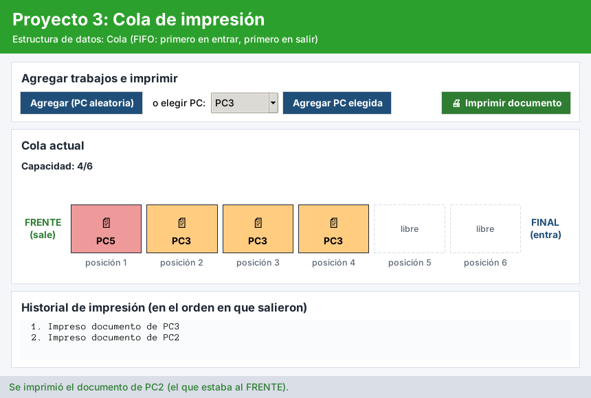

# Proyecto 3 — Cola de impresión (Cola FIFO de capacidad limitada)

[← Volver al README](../README.md) · Código: [`proyectos/p3_cola_impresion.py`](../proyectos/p3_cola_impresion.py) · Ventana: [`interfaz/ventana_cola.py`](../interfaz/ventana_cola.py)

## ¿Qué hace?

Cinco computadoras (`PC1` a `PC5`) mandan documentos a **una impresora**. Los trabajos esperan en una **cola** de máximo **6** lugares y se imprimen **en el orden en que llegaron**.

## La estructura: Cola

Una **cola** funciona como la fila de un banco: el **primero en entrar es el primero en salir** (FIFO, *First In, First Out*). Se agrega por el **final** y se atiende por el **frente**.

```python
CAPACIDAD_MAXIMA = 6
COMPUTADORAS = ["PC1", "PC2", "PC3", "PC4", "PC5"]
```

| Método | Qué hace | Complejidad |
|--------|----------|-------------|
| `esta_vacia()` | `len(self.items) == 0` | O(1) |
| `esta_llena()` | `len(self.items) >= self.capacidad` | O(1) |
| `encolar(e)` | si no está llena, `append` al final y regresa `True`; si está llena regresa `False` | O(1) |
| `desencolar()` | si no está vacía, `pop(0)` (quita el del frente) y lo regresa; si está vacía regresa `None` | O(n) |

La cola es **acotada** (*bounded*): `esta_llena()` evita que se agreguen más de 6 trabajos, como el buffer de una impresora real.

## Ejemplo

| Acción | Cola (frente → final) | Capacidad |
|--------|----------------------|-----------|
| Agregar PC3 | PC3 | 1/6 |
| Agregar PC1 | PC3 → PC1 | 2/6 |
| Agregar PC5 | PC3 → PC1 → PC5 | 3/6 |
| Imprimir | PC1 → PC5 (salió **PC3**, el primero) | 2/6 |

## Menú original (consola)

1. **Agregar trabajo (PC aleatoria)**: `random.choice(COMPUTADORAS)`.
2. **Agregar trabajo (seleccionar PC)**: se escribe el nombre; `.strip().upper()` permite escribir `pc2`.
3. **Imprimir documento**: `desencolar()`.
4. **Mostrar cola**: `" -> ".join(cola.items)` y la capacidad usada.

## La ventana gráfica

- Botones para agregar con PC aleatoria o elegida en una lista, y **🖨 Imprimir documento**.
- Se dibujan los **6 lugares** de la cola con **FRENTE (sale)** a la izquierda y **FINAL (entra)** a la derecha; cada PC tiene su color.
- **Historial de impresión**: lista con el orden en que se imprimieron los documentos, que demuestra el FIFO.



## Preguntas que podría hacer el profe

- **¿Qué pasa si la cola está llena?** `encolar` regresa `False` y no agrega nada; el menú avisa "LLENA".
- **¿Por qué `pop(0)` es O(n)?** Porque al quitar el primer elemento de una lista Python recorre todos los demás un lugar a la izquierda. Una mejora sería usar `collections.deque`, cuyo `popleft()` es O(1). Con capacidad 6 la diferencia no se nota.
- **¿Diferencia con la pila del proyecto 1?** En la pila se quita el **último** que entró; en la cola se quita el **primero**.
