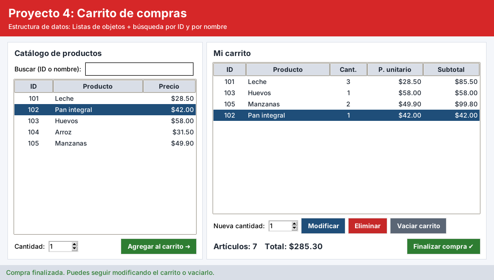

# Proyecto 4 — Carrito de compras (Listas de objetos y búsqueda)

[← Volver al README](../README.md) · Código: [`proyectos/p4_carrito_compras.py`](../proyectos/p4_carrito_compras.py) · Ventana: [`interfaz/ventana_carrito.py`](../interfaz/ventana_carrito.py)

## ¿Qué hace?

Un sistema de compras con un **catálogo** de productos y un **carrito**: buscar productos, agregarlos, cambiar cantidades, eliminarlos, vaciar el carrito y finalizar la compra con el total.

## Las clases

```
Producto              ElementoCarrito                Carrito
---------             ----------------               -------------------------
id_producto           producto: Producto   ──┐       elementos: List[ElementoCarrito]
nombre                cantidad               │
precio                calcular_subtotal()    └─ cada línea del carrito
                      actualizar_cantidad()

SistemaCarrito
--------------
catalogo: List[Producto]      ← lista de objetos Producto
carrito: Carrito
menú de consola, búsquedas en el catálogo
```

- `Producto` y `ElementoCarrito` son **`@dataclass`**: Python genera solo el `__init__` con los atributos declarados.
- El **catálogo** es una lista de 5 productos (Leche, Pan integral, Huevos, Arroz, Manzanas).
- El **carrito** es una lista de `ElementoCarrito` (producto + cantidad). El **subtotal** de cada línea es `precio * cantidad` y el **total** es la suma de los subtotales.

## La estructura: Listas y búsqueda lineal

Todas las búsquedas recorren la lista elemento por elemento (**búsqueda lineal, O(n)**):

| Método | Busca en | Criterio |
|--------|----------|----------|
| `SistemaCarrito.buscar_producto_por_id` | catálogo | `producto.id_producto == id` → regresa uno o `None` |
| `SistemaCarrito.buscar_productos_por_nombre` | catálogo | el texto **está contenido** en el nombre (sin importar mayúsculas, con `casefold()`) → regresa una lista |
| `Carrito.buscar_por_id` | carrito | mismo ID |
| `Carrito.buscar_por_nombre` | carrito | nombre **exacto** (sin importar mayúsculas) |

`casefold()` es como `lower()` pero más completo; sirve para comparar sin que importen las mayúsculas.

## Operaciones del carrito

| Método | Qué hace | Complejidad |
|--------|----------|-------------|
| `agregar_producto(p, cant)` | si el producto **ya está**, suma la cantidad; si no, agrega un `ElementoCarrito` nuevo (así no hay líneas repetidas) | O(n) por la búsqueda |
| `modificar_cantidad(el, cant)` | cambia la cantidad de una línea | O(1) |
| `eliminar_producto(el)` | `self.elementos.remove(el)` | O(n) |
| `vaciar()` | `self.elementos.clear()` | O(n) |
| `calcular_total()` | suma de `calcular_subtotal()` de cada elemento | O(n) |
| `calcular_cantidad_total()` | suma de cantidades | O(n) |

## Ejemplo

| Acción | Carrito | Total |
|--------|---------|-------|
| Agregar 2 Leche ($28.50) | Leche ×2 = $57.00 | $57.00 |
| Agregar 1 Huevos ($58.00) | Leche ×2, Huevos ×1 | $115.00 |
| Agregar 1 Leche **otra vez** | Leche ×**3** = $85.50, Huevos ×1 | $143.50 |

## La ventana gráfica

- **Izquierda:** catálogo en una tabla (`ttk.Treeview`). El cuadro **Buscar** filtra mientras escribes: si escribes un número busca por **ID**, si escribes texto busca por **nombre**. Se agrega con el botón o con doble clic.
- **Derecha:** el carrito con cantidad, precio unitario y subtotal. Al seleccionar una línea se puede **Modificar** la cantidad, **Eliminar** o **Vaciar carrito**.
- Abajo: artículos totales, **Total** y **Finalizar compra**, que muestra el resumen.



## Preguntas que podría hacer el profe

- **¿Por qué es una lista de objetos y no una lista de números?** Cada elemento guarda varios datos relacionados (producto, cantidad) y tiene sus propios métodos (`calcular_subtotal`).
- **¿Cómo se evita tener el mismo producto dos veces?** `agregar_producto` primero lo busca con `buscar_por_id`; si existe, solo aumenta la cantidad.
- **¿Qué búsqueda usan y cuánto cuesta?** Lineal, O(n). Para muchos productos se podría usar un diccionario `{id: producto}` con búsqueda O(1).
