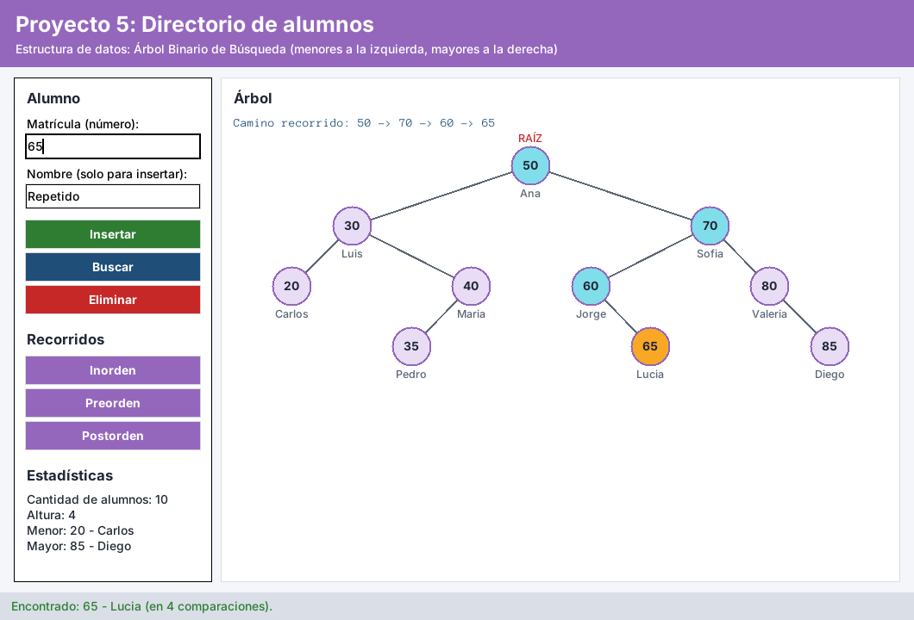
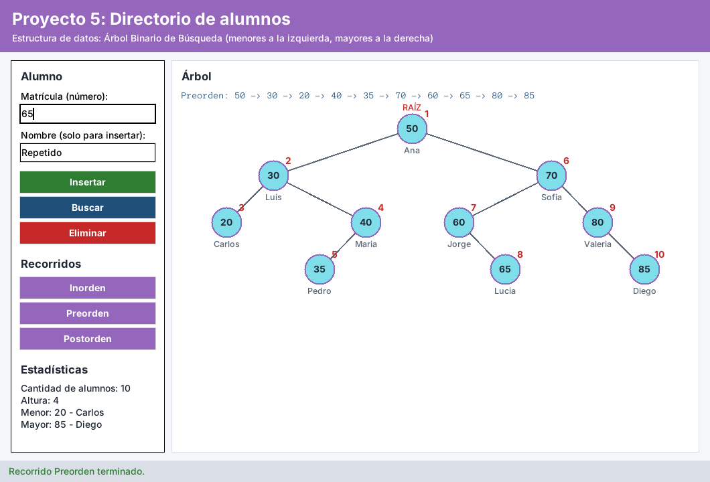

# Proyecto 5 — Directorio de alumnos con Árbol Binario de Búsqueda

[← Volver al README](../README.md) · Código: [`proyectos/p5_arbol_alumnos.py`](../proyectos/p5_arbol_alumnos.py) · Ventana: [`interfaz/ventana_arbol.py`](../interfaz/ventana_arbol.py)

## ¿Qué hace?

Guarda alumnos (**matrícula** y **nombre**) en un **árbol binario de búsqueda** (ABB) ordenado por matrícula. Permite insertar, buscar, eliminar, ver los tres recorridos y algunas estadísticas (cantidad, altura, menor y mayor).

Arranca con 7 alumnos de ejemplo (`cargar_alumnos_ejemplo`) para que el árbol no empiece vacío:

```
              50 Ana
            /        \
       30 Luis      70 Sofia
       /    \        /     \
  20 Carlos 40 Maria 60 Jorge 80 Valeria
```

## La estructura: Árbol Binario de Búsqueda

Un **árbol binario** está formado por **nodos**, y cada nodo tiene como máximo **dos hijos** (izquierdo y derecho). El nodo de hasta arriba es la **raíz**, y los nodos sin hijos son **hojas**.

Es **de búsqueda** porque cumple esta regla en **todos** los nodos:

> Todo lo que está en el subárbol **izquierdo** es **menor** y todo lo que está en el subárbol **derecho** es **mayor**.

Gracias a esa regla, para buscar no hay que revisar todo: en cada nodo se decide si ir a la izquierda o a la derecha, igual que en una búsqueda binaria.

### Clases

```python
class Nodo:
    matricula, nombre        # datos
    izquierdo, derecho       # referencias a los hijos (o None)

class ArbolBinarioBusqueda:
    raiz                     # primer nodo (None si está vacío)
    cantidad                 # número de alumnos
```

## Operaciones

### Insertar — `insertar(matricula, nombre)`
1. Si el árbol está vacío, el nuevo nodo es la **raíz**.
2. Si no, se baja desde la raíz: si la matrícula es **menor** se va a la izquierda y si es **mayor** a la derecha, hasta encontrar un hueco (`None`) y ahí se coloca.
3. Si la matrícula **ya existe**, regresa `False` (no se permiten repetidas).

Ejemplo: insertar **65** → 65 > 50 (derecha) → 65 < 70 (izquierda) → 65 > 60 (derecha, hueco) → queda como hijo derecho de 60.

### Buscar — `buscar(matricula)`
Baja igual que insertar y va guardando el **camino** recorrido. Regresa el nodo (o `None`) y el camino, que la ventana pinta en azul.

### Eliminar — `eliminar(matricula)` → los 3 casos

| Caso | Qué se hace |
|------|-------------|
| **1. Es hoja** (0 hijos) | Simplemente se quita. |
| **2. Tiene 1 hijo** | El hijo toma su lugar. |
| **3. Tiene 2 hijos** | Se busca su **sucesor** (el **menor del subárbol derecho**), se copian sus datos en el nodo y después se elimina el sucesor (que cae en el caso 1 o 2). |

Ejemplo: eliminar la raíz **50** (2 hijos) → su sucesor es **60** → 60 pasa a ser la raíz.

`_eliminar` es **recursivo**: regresa la nueva raíz de cada subárbol para que el padre actualice su referencia.

### Recorridos (los tres son recursivos, O(n))

| Recorrido | Orden | Resultado con el árbol de ejemplo | Para qué sirve |
|-----------|-------|-----------------------------------|----------------|
| **Inorden** | Izquierdo → **Raíz** → Derecho | 20, 30, 40, 50, 60, 70, 80 | Sale **ordenado** de menor a mayor |
| **Preorden** | **Raíz** → Izquierdo → Derecho | 50, 30, 20, 40, 70, 60, 80 | Copiar o guardar el árbol con la misma forma |
| **Postorden** | Izquierdo → Derecho → **Raíz** | 20, 40, 30, 60, 80, 70, 50 | Borrar el árbol (primero los hijos) |

### Estadísticas
- **Altura**: `1 + max(altura(izq), altura(der))`, recursivo. El árbol de ejemplo tiene altura 3.
- **Mínimo**: bajar siempre a la izquierda. **Máximo**: bajar siempre a la derecha.

## Complejidad

| Operación | Árbol balanceado | Peor caso (árbol "chueco") |
|-----------|------------------|----------------------------|
| Insertar / buscar / eliminar | O(log n) | O(n) |
| Recorridos | O(n) | O(n) |

El **peor caso** ocurre si se insertan las matrículas **ya ordenadas** (10, 20, 30, 40…): cada nodo queda a la derecha del anterior y el árbol se vuelve una lista. Los árboles **AVL** o **rojo-negro** se balancean solos para evitarlo.

## La ventana gráfica

- **Izquierda:** campos de matrícula y nombre, y botones **Insertar**, **Buscar** y **Eliminar**. Debajo, los recorridos y las estadísticas.
- **Derecha:** el árbol dibujado en un `Canvas`. Cada nodo se coloca:
  - en **x** según su posición en el recorrido **inorden** (por eso nunca se enciman y quedan ordenados de izquierda a derecha);
  - en **y** según su **nivel** (profundidad).
- **Buscar** pinta en azul el **camino** y en amarillo el nodo encontrado.
- Los **recorridos** se animan: cada nodo se pinta en orden y se le pone su número de visita.




## Menú de consola (versión original)

`python proyectos/p5_arbol_alumnos.py` muestra un menú igual al de los otros proyectos: 1 Insertar, 2 Buscar, 3 Eliminar, 4 Recorridos, 5 Estadísticas, 6 Salir.

## Preguntas que podría hacer el profe

- **¿Por qué el inorden sale ordenado?** Porque visita primero todo lo menor (izquierda), luego el nodo y luego todo lo mayor (derecha).
- **¿Por qué en el caso de 2 hijos se usa el sucesor?** Porque es el valor más pequeño que es mayor que el nodo: al ponerlo en su lugar se sigue cumpliendo la regla del ABB.
- **¿Qué ventaja tiene sobre una lista?** En una lista buscar es O(n); en un ABB balanceado es O(log n) y además los datos se mantienen ordenados.
