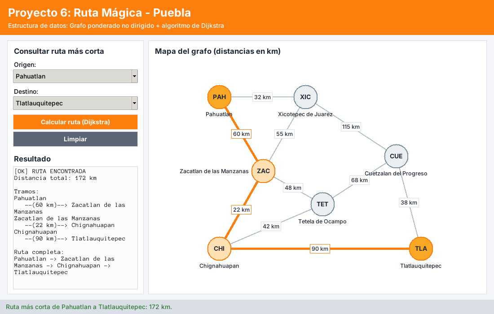

# Proyecto 6 — Ruta Mágica: Grafos y algoritmo de Dijkstra

[← Volver al README](../README.md) · Código: [`proyectos/p6_pueblos_magicos.py`](../proyectos/p6_pueblos_magicos.py) · Ventana: [`interfaz/ventana_pueblos.py`](../interfaz/ventana_pueblos.py)

## ¿Qué hace?

Encuentra el **camino más corto** (en kilómetros) entre dos Pueblos Mágicos de la Sierra Norte de **Puebla**.

## La estructura: Grafo ponderado no dirigido

Un **grafo** está formado por:

- **Vértices (nodos):** los pueblos → clase `PuebloMagico` (índice, nombre, clave como `ZAC`).
- **Aristas:** las carreteras → clase `Arista` (destino y `distancia_km`).

Es **ponderado** porque cada arista tiene un **peso** (los km), y **no dirigido** porque se puede ir en los dos sentidos: `agregar_carretera(..., bidireccional=True)` agrega la arista de A→B y de B→A.

### Lista de adyacencia

`GrafoPueblosMagicos` guarda el grafo como una **lista de adyacencia**: un diccionario donde cada pueblo tiene la lista de carreteras que salen de él.

```python
self.adyacencia = {
    "Zacatlan de las Manzanas": [Arista("Chignahuapan", 22), Arista("Tetela de Ocampo", 48),
                                 Arista("Xicotepec de Juarez", 55), Arista("Pahuatlan", 60)],
    "Chignahuapan": [Arista("Zacatlan de las Manzanas", 22), ...],
    ...
}
```

Con la lista de adyacencia se ocupa memoria solo para las carreteras que existen, a diferencia de una matriz de adyacencia (V × V).

### El grafo de Puebla (7 vértices, 10 aristas)

| Carretera | km |
|-----------|----|
| Zacatlán – Chignahuapan | 22 |
| Xicotepec – Pahuatlán | 32 |
| Cuetzalan – Tlatlauquitepec | 38 |
| Chignahuapan – Tetela | 42 |
| Zacatlán – Tetela | 48 |
| Zacatlán – Xicotepec | 55 |
| Pahuatlán – Zacatlán | 60 |
| Tetela – Cuetzalan | 68 |
| Chignahuapan – Tlatlauquitepec | 90 |
| Xicotepec – Cuetzalan | 115 |

## Algoritmo de Dijkstra — `dijkstra(origen, destino)`

Idea: ir "expandiendo" desde el origen, siempre por el pueblo **más cercano que aún no se ha confirmado**.

1. `distancias`: todos en **infinito**, menos el origen, que vale **0**.
2. `anteriores`: de qué pueblo venimos a cada uno (para reconstruir el camino).
3. `cola_prioridad`: un **montículo mínimo** (`heapq`) que siempre entrega el par `(distancia, pueblo)` con la **menor** distancia.
4. Mientras haya elementos en la cola:
   - Se saca el más cercano (`heappop`).
   - Si su distancia es mayor que la ya guardada, es un dato viejo y se ignora (`continue`).
   - Si es el destino, se termina antes (`break`).
   - Para cada vecino: si `distancia_actual + km` es **mejor** que lo guardado, se **actualiza** (esto se llama **relajar** la arista) y se mete a la cola.
5. Si el destino quedó en infinito, no hay ruta.
6. Se reconstruye el camino yendo hacia atrás con `anteriores` desde el destino y se invierte (`reverse()`).
7. Se arman los **tramos** `(u, v, km)` para mostrar cada carretera usada.

### Ejemplo: Pahuatlán → Tlatlauquitepec

| Ruta posible | km |
|--------------|----|
| **Pahuatlán → Zacatlán → Chignahuapan → Tlatlauquitepec** | 60 + 22 + 90 = **172** ✅ |
| Pahuatlán → Xicotepec → Cuetzalan → Tlatlauquitepec | 32 + 115 + 38 = 185 |
| Pahuatlán → Zacatlán → Tetela → Cuetzalan → Tlatlauquitepec | 60 + 48 + 68 + 38 = 214 |

Dijkstra regresa la de **172 km**.

### Complejidad
Con montículo binario: **O((V + E) log V)**, donde V = pueblos y E = carreteras. Dijkstra funciona porque **no hay pesos negativos** (no existen kilómetros negativos).

## La ventana gráfica

- Se eligen **Origen** y **Destino** en listas desplegables y se presiona **Calcular ruta (Dijkstra)**.
- El grafo se dibuja en un `Canvas`: círculos con la clave del pueblo y líneas con los km. La **ruta encontrada se pinta en naranja**; el origen y el destino van en amarillo.
- El panel **Resultado** muestra la distancia total, los tramos y la ruta completa, igual que la versión de consola.
- La posición de los pueblos en el dibujo es aproximada (parecida al mapa real) y **solo sirve para dibujar**: el algoritmo no la usa.



## Preguntas que podría hacer el profe

- **¿Por qué se usa `heapq`?** Para sacar el pueblo más cercano en O(log V) en lugar de buscarlo recorriendo todos (O(V)).
- **¿Para qué sirve `anteriores`?** Dijkstra solo calcula distancias; `anteriores` permite reconstruir **por dónde** se pasó.
- **¿Qué pasa si hubiera un pueblo sin carreteras?** Su distancia quedaría en infinito y el programa diría "No existe ruta conectada entre esos pueblos".
- **¿Por qué el `continue` cuando `distancia_actual > distancias[nodo_actual]`?** Un pueblo puede entrar varias veces a la cola; esa línea ignora las entradas viejas que ya fueron mejoradas.
